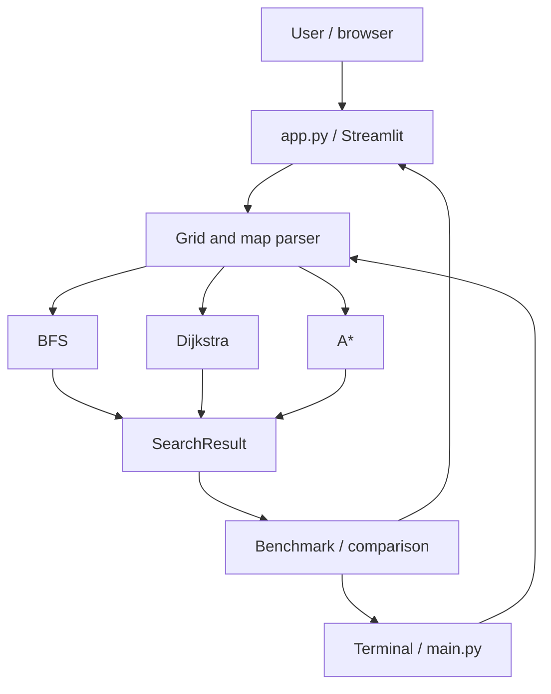

# Architecture

## Design goal

Keep algorithm correctness independently testable. Streamlit is an optional interface on top of pure-Python modules. The command-line runner uses exactly the same core search functions as the browser app.

## Modules

- **`pathfinder/grid.py`** — validated `Grid` model, neighbor generation, entry costs, pure `edit()` operations, strict text-map parsing and ASCII output.
- **`pathfinder/algorithms.py`** — independent BFS, Dijkstra, A* functions and immutable `SearchResult`. The engine has no Streamlit/Plotly dependency.
- **`pathfinder/benchmark.py`** — median elapsed-time measurement and result collection.
- **`pathfinder/examples.py`** — known cases and deterministic seeded random input.
- **`app.py`** — UI state, editable cell controls, visualization and animation.
- **`main.py`** — command-line runner and reusable text-map interface.

## Important invariants

1. A grid has one start and one goal, at different locations.
2. Walls are not traversable; start and goal cannot be walls.
3. A move changes either row or column by exactly one, never both.
4. Costs are positive integers 1–9, with no charge for the start cell.
5. The `Grid.edit()` method returns a **new** validated instance.
6. BFS optimizes steps; Dijkstra and A* optimize total cost.
7. A* and Dijkstra must return equal minimum costs, or both report unreachable.

## UI event lifecycle

When a user edits a cell or loads/generates a map, the app invalidates the previous analysis result. Pressing **Run all algorithms** then computes a new comparison tied to the current map. Switching the visible algorithm selects a cached result for that map. Animation replays the selected result's recorded `visited_order`, followed by the final route.

## Engineering trade-offs

A 14×14 maximum grid in the web generator keeps the click-to-edit UI practical. The data model accepts up to 30×30 to support CLI experimentation. The app intentionally does not use geospatial services or external API keys.
